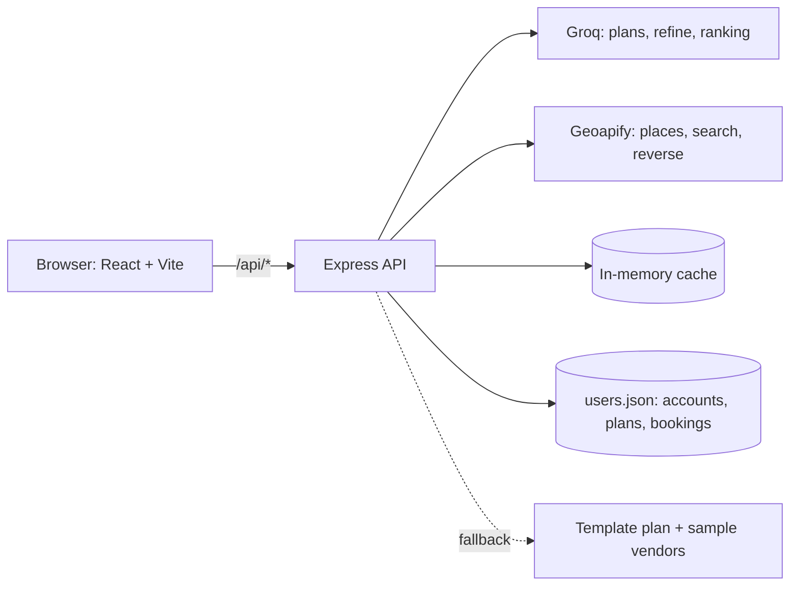
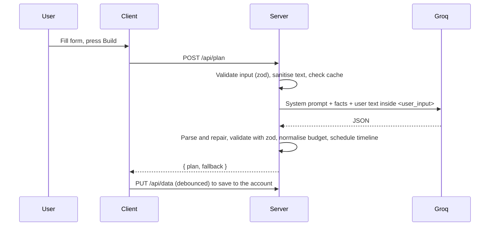
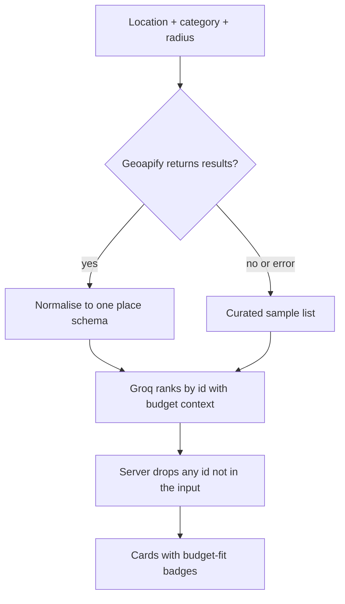

# Architecture

## Overview

EventCraft is a React single-page app talking to a small Express API. The browser never sees an API key: every call to Groq or Geoapify goes through the server.

In development the Vite dev server proxies `/api` to port 4000, so the browser sees one origin and the session cookie is first-party.

## Key flows

### 1. Building a plan

If Groq fails or returns something unusable, the server returns a deterministic template plan and a `fallback: true` flag, and the UI says so.

### 2. Date-aware timeline

The AI proposes tasks with an *ideal* lead time and a *minimum notice* in days. The server (not the AI) turns these into dates using `scheduleTimeline` in `utils.js`:

- Enough time (90+ days): ideal lead times are kept.
- Less time: each lead time is scaled down proportionally, never below 1 day, never before today. The earliest task becomes "Start today".
- A task is flagged **Rush** when the squeezed lead time is below the notice a vendor realistically needs.

Doing this in code means the dates are always correct, whatever the AI returns.

### 3. Refining a plan

`POST /api/plan/refine` sends the current plan, the new details and the earlier details. The AI is asked to revise (not restart), explain what changed, and ask new follow-up questions. The same parsing, budget normalisation and scheduling run again. If the AI is unavailable, the plan is returned unchanged and the UI says nothing was changed.

### 4. Vendor discovery

Budget fit is calculated in the client from the plan: the budget line for the category, divided by guests, gives a tier (budget-friendly, mid-range, premium) that is compared with each place's price level when one exists. Missing prices show "Ask for a quote" instead of guessing.

### 5. Accounts and per-user data

- Passwords are hashed with scrypt and a random salt.
- A session is a signed token (user id and expiry, HMAC-SHA256) in an `HttpOnly`, `SameSite=Lax` cookie, valid for 7 days.
- `GET/PUT /api/data` read and write only the logged-in user's record, found from the token, never from a client-supplied id.
- The client loads the data after login, saves changes after a short pause, and clears everything on logout.

## Design decisions

| Decision | Reason |
|---|---|
| The AI never supplies places or contacts | Language models invent plausible but fake businesses. Real data comes from a places API. |
| zod on every input and every AI reply | Untrusted input and unreliable AI output both get the same treatment. |
| Tolerant AI parsing, then fallback | Models return slightly different shapes. The schema accepts common variants, and a template plan is the last resort. |
| Dates computed in code | Models are unreliable with dates. |
| Provider fallbacks (Geoapify, then sample list) | The demo must not break when a quota or network fails. |
| Auto-discovery of a Groq model | Available models differ by account. |
| JSON-file user store | No native dependencies or database setup. Isolated in `userStore.js` so it can be replaced. |
| Caching in memory | Places 24h, plans 1h, search 5min. Simple and enough for one server. |
| Code-split pages | The first load only fetches the home page code. |

## Where to change things

| To change | Edit |
|---|---|
| The AI prompt or model choice | `server/src/services.js` |
| Plan shape accepted from the AI | `server/src/schemas.js` |
| Timeline logic, budget splits, template plan | `server/src/utils.js` |
| Which Geoapify categories are searched | `CATS` in `server/src/services.js` |
| Budget-fit thresholds | `PER_GUEST` and `tierFor` in `client/src/pages/Discover.jsx` |
| Colours and spacing | `client/src/styles.css` (variables at the top) |
| Sample vendors | `server/data/curatedVendors.json` |
